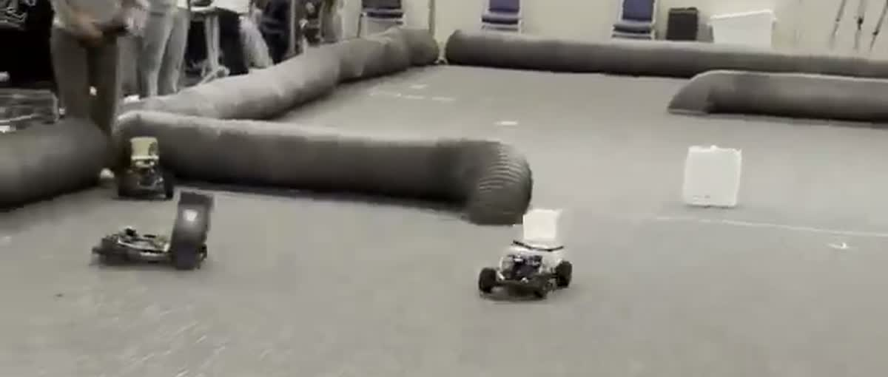

# F1TENTH Adaptive Racing Control

**LiDAR-based adaptive speed and steering control for F1TENTH autonomous racing using TinyLidarNet and ROS 2.**

## Overview

This repository documents modifications to a TinyLidarNet-based inference node used in an F1TENTH autonomous racing project. The project used a pre-existing ROS 2 racing stack on a Jetson board; the work focused on adapting neural network outputs to driving conditions through LiDAR-based speed regulation, speed-dependent steering constraints, and parameter tuning.

**Scope:** This repository contains the modified inference-node source rather than a standalone, fully reproducible ROS 2 racing stack. The underlying packages and pretrained models are not included.

## Competition Run

**Result:** 8th Place · Encouragement Award<br>
**Event:** 2025 The 4th F1TENTH Korea Championship · ICCAS 2025

<p align="center">
  <a href="assets/competition-run.mp4">
    
  </a>
</p>

The clip shows the vehicle operating on the autonomous driving competition course. It is provided as a qualitative demonstration rather than a performance benchmark.

[Watch the 17-second competition run](assets/competition-run.mp4)

## System Flow

```text
LiDAR (/scan)
    │
    ├── Forward distance estimate ──> Dynamic maximum speed
    │
    └── Scan preprocessing ──> TinyLidarNet inference
                                   │
                              Speed / steering
                                   │
                      ┌────────────┴────────────┐
                      │                         │
               Speed adjustment          Steering smoothing
               + dynamic bounds          + speed-based limit
                      │                         │
                      └────────────┬────────────┘
                                   ▼
                         Ackermann command (/drive)
```

## Implemented Control Logic

| Component | Implementation |
| --- | --- |
| LiDAR-aware speed bound | Calculates mean distance within a configurable forward-facing field of view and maps it to a dynamic maximum speed. |
| Speed-dependent steering bound | Limits the allowable steering magnitude according to the commanded speed. |
| Exponential steering scaling | Uses an exponential decay function for the intermediate speed range. |
| Cornering speed reduction | Reduces speed based on steering demand, with a tunable curve-speed weight. |
| Steering smoothing | Applies exponential moving average (EMA) to predicted steering. |
| ROS 2 interfaces | Subscribes to `/scan` and can publish `AckermannDriveStamped` messages on `/drive`. |

The node performs inference with TensorFlow/Keras. Its steering and speed outputs are post-processed before a drive command is published.

### Selected parameters

| Parameter | Value in the shared source |
| --- | ---: |
| `V_MIN` | 2.5 |
| `V_MAX` | 30.0 |
| `FACTOR_ZERO_DIST` | 4.0 m |
| `FACTOR_ONE_DIST` | 10.0 m |
| `FACTOR_FOV_DEG_` | 25° |
| `ONE_STEER_MIN_V` | 4.5 |
| `ZERO_STEER_MAX_V` | 21.0 |
| `STEER_ABS_MAX` | 0.36 rad |
| `K_FOR_EXP_DECAY` | 0.35 |

These are **code configuration values, not benchmark results**. The source includes an iterative tuning log in its header.

## Development Environment

- **Platform:** NVIDIA Jetson board (on-device deployment in the original project)
- **Middleware:** ROS 2 Humble
- **Container environment:** Existing Docker-based F1TENTH / Forza racing stack
- **Language:** Python
- **Inference:** TensorFlow / Keras, TinyLidarNet
- **Sensor:** 2D LiDAR
- **Control messages:** `ackermann_msgs/AckermannDriveStamped`

## Repository Structure

```text
.
├── README.md
└── src/
    └── inference_node.py
```

The source belongs in the original ROS 2 `ofc` Python package, where its project-relative location was `ofc/ofc/inference_node.py`.

## Integration Notes

To integrate with the original stack:

1. Use a compatible ROS 2 environment with the `ofc` package and its launch/configuration files.
2. Place the provided `inference_node.py` in the corresponding Python package.
3. Supply the required Keras model at the package share path: `models/tinylidarnet_finetuned_1103.keras`.
4. Build/source the workspace as needed and configure `drive_publish_enabled` in the launch parameters when command publication is intended.
5. Validate model input shape, LiDAR geometry, steering sign, and vehicle-specific safety bounds before operating hardware.

**Important:** The fine-tuned Keras weights referenced by the source are **not included** here. The available Docker image was observed to contain other Keras models, but not this exact filename. The source and integration have **not been independently re-tested** as part of this repository publication.

## Known Limitations

- The implementation assumes an input scan of 1080 or 1081 points and a fixed 1081-point angular geometry; it is not sensor-agnostic.
- The current distance-based speed factor is not clipped to `[0, 1]`, so the calculated dynamic maximum may exceed the nominal `V_MAX`.
- The current `np.flip(..., out=...)` call in the optional reverse-direction path is incompatible with standard NumPy.
- The speed-dependent steering factor reaches zero abruptly at its configured upper speed threshold.
- No measured lap times, completion rates, or head-to-head benchmarks are provided here.

## Attribution

Built on an existing F1TENTH / Forza-based ROS 2 racing stack and TinyLidarNet inference pipeline. This repository documents an adapted inference-node implementation, **not authorship of the complete original autonomous racing stack**. Refer to the underlying projects for their original code, dependencies, and licenses.

## Status

**Portfolio / source publication.** Reproducing the complete onboard deployment requires the original ROS 2 stack, model checkpoint, and hardware configuration.
